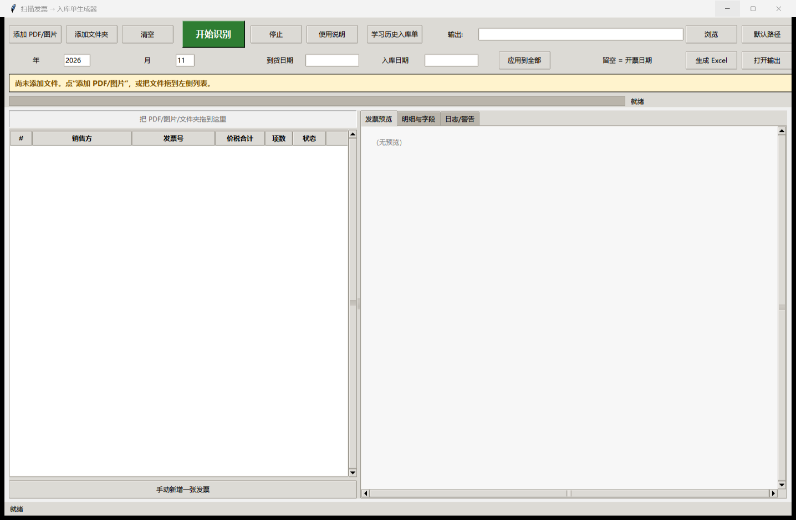

# 扫描发票 → 入库单生成器（Invoice2RKD）

**把一堆发票 PDF/图片，变成能直接打印的入库单 Excel。**

如果你每个月都要把发票上的项目名称、规格、数量、单价、税额手工抄进入库单，这个工具可以省掉大部分复制粘贴。它按公司入库单模板生成 `.xls`，打印设置已适配 Epson LQ-730K 三联复写纸。



> Windows 10/11 · 本地离线 · MIT License  
> 当前 v1.2：电子发票文字层 + 扫描件 OCR 双路径、优惠行合并、卖方识别增强已可用。

---

## 它解决什么问题

- 发票 PDF/图片一张张打开、复制项目名称/规格/数量/单价/税额，太费时间。
- 公司入库单格式固定，但手工抄容易错行、漏行、金额对不上。
- 不想把发票上传到在线 OCR/大模型；公司数据最好只留在本机。
- 想让同事也能用，但不想让他们装 Python、配环境。

这个工具做三件事：

1. **识别**：把发票 PDF/图片里的销售方、发票号、日期、明细、金额、税额读出来。
2. **校对**：在界面里改字段、改明细、补行、补单位。
3. **出表**：按旧入库单模板生成 `.xls`，直接打印/归档。

适合采购、财务、仓管、行政等需要批量整理发票的岗位；不追求“100% 无人值守”，但希望把最耗时的抄写和排版自动化。

---

## 功能

- 支持 PDF、PNG、JPG、BMP、TIFF、WEBP；可批量添加，也可直接把文件/文件夹拖到左侧列表。
- 电子发票优先解析 PDF 文字层，准确且快；扫描件/图片自动走本地 OCR；混合 PDF 按页选择。
- 扫描件自动旋转、增强，本地 OCR 识别；读取发票二维码核对发票号/日期/价税合计。
- 优惠/折扣负数行自动合并成一条净额明细，不输出负金额、负单价。
- 销售方取右侧销售方全称；购买方是“个人”时不会误当卖方。
- 自动跳过费用报销单等非发票页；同一张发票重复扫描只录一次。
- 软件内“公司设置”：填写入库单标题、购买方公司名称，保存后立即生效。
- 识别后可在界面校对：改字段、改明细、补行、补单位。
- 生成 `.xls`：每张发票一个工作表，表名 = 供应商简写 + 价税合计（重名加 `-MMDD`）。
- 打印设置按 Epson LQ-730K 三联复写纸配置：286 纸型、纵向、1 页宽 × 1 页高、左右 0.2in / 上下 0.4in、页眉页脚为空。
- 可“学习历史入库单”，提高项目名称、规格、单位匹配；学习库只保存在本机。

---

## 快速开始

### 普通用户（推荐）

1. 到本仓库的 **Releases** 下载 `入库单生成器-便携版.zip`。
2. 解压后双击 `入库单生成器\入库单生成器.exe`（不要只复制 exe，需要同目录的 `_internal`）。
3. 第一次使用，点右上角 **“公司设置”**，填写入库单标题和购买方公司名称，保存即可。
4. 把发票 PDF/图片拖到左侧列表，或点“添加 PDF/图片”。
5. 识别模式保持默认“自动（推荐）”即可：电子票走文字层，扫描件走 OCR。
6. 点上方绿色大按钮“开始识别”。
7. 在左侧选发票，在“明细与字段”里核对；双击明细行可编辑。
8. 设好年份/月份和输出路径，点“生成 Excel”。

不需要安装 Python；生成 Excel 不需要 Office，只有“导出 PDF 做版式检查”需要 Excel。

### 从源码运行（开发者）

先把 `data/company.json` 改成你的公司名（见下一节），再：

Windows 10/11，Python 3.10+（建议 3.12）：

```powershell
python -m venv .venv
.venv\Scripts\activate
pip install -r requirements.txt
python app.py
```

### 打包便携版

```powershell
powershell -ExecutionPolicy Bypass -File build.ps1
```

输出在 `dist\入库单生成器\`，可整个文件夹压缩发给同事。

---

## 改成你的公司名

打开软件，点右上角 **“公司设置”**：

- **入库单标题**：显示在每张入库单顶部，例如“XX公司入库单”。
- **购买方公司名称**：识别时用来排除购买方，避免把本公司当成销售方。

保存后立即生效，生成 Excel 时就会使用新的标题。设置保存在本机：

```
%LOCALAPPDATA%\Invoice2RKD\company_public.json
```

不会修改安装包里的 `data/company.json`。高级用户仍可直接编辑
`_internal\data\company.json` 作为默认值，但界面设置优先。

---

## 输出效果

- 每张发票一个工作表。
- 表名 = 供应商简写 + 价税合计；重名时加 `-MMDD`。
- 表头：序号 / 材料名称 / 规格型号 / 单位 / 数量 / 单价 / 单价含税（隐藏）/ 金额 / 税金 / 含税价 / 到货时间 / 入库时间 / 备注。
- 合计行：金额 + 税金 = 含税价 = 发票价税合计。
- 打印：286 纸型（9.5×5.5 英寸）、纵向、1 页宽×1 页高、左右 0.2in / 上下 0.4in。
- 示例：[examples/示例-入库单.xls](examples/示例-入库单.xls)（纯虚构数据）。

---

## 为什么电子票不直接用 OCR？

这是这个项目最重要的设计点：

- **电子 PDF 有文字层**：发票号、公司名、金额本来就是精确文本，应该直接解析文字层。
- **扫描件/图片没有文字层**：只能 OCR。
- 把电子 PDF 渲染成图片再 OCR，等于“把准确的文字打印出来再扫描一遍”，会引入列粘连、竖排标签漏识别、小数点/负数看错等问题。

所以 v1.2 采用 **双路径**，不是二选一：

```
电子页 → 文字层解析（pdfplumber 坐标）
扫描页 → OCR（RapidOCR）
文字层失败/校验不过 → OCR 回退
两边都有 → 交叉校验，文字层优先
混合 PDF → 按页判断
```

文字层完全通过校验时不会再跑 OCR（所以电子票很快）；只有文字层缺字段/金额不一致时才回退 OCR 做交叉校验。二维码始终参与号码/日期/价税合计校验。

界面“识别模式”可选：

- **自动（推荐）**：电子页优先文字层，扫描页/失败页回退 OCR。
- **仅文字层（电子票）**：只解析文字层；扫描页会明确跳过，适合排查电子票问题。
- **仅OCR（扫描件）**：强制走 OCR，适合排查扫描件问题。

命令行对应 `--mode auto|text|ocr`。

---

## 使用要点

- 一张发票一个工作表；发票项目名称/规格会尽量保留全文，不截断。
- 单价 = 不含税单价；税金 = 金额 × 税率（2 位）；含税价 = 发票价税合计。
- 商品行后面跟负数优惠行时，会自动合并成一条净额明细；单价 = 净金额 / 数量。
- 销售方固定取右侧“销售方”信息；购买方是“个人”也不会误当卖方。
- 到货时间/入库时间默认 = 开票日期，可在界面统一改。
- 识别结果有疑问时，发票状态会显示“注意”，请查看“日志/警告”并按提示人工校对。
- 极少数模糊扫描件可能漏行或缺单位，软件会提示；在“明细与字段”里“添加行”或直接补单位即可。
- PDF 版式检查依赖默认打印机驱动。如果提示 `##/####`，通常是把默认打印机切到了不支持 286 纸型的驱动；把默认打印机切换为 **EPSON LQ-730K** 后再检查。`.xls` 本身已生成，打印设置不受影响。

---

## 工作原理

```
PDF/图片
  → 按页判断
     ├─ 有文字层：pdfplumber 取 words/坐标 → 文字层解析
     └─ 无文字层/解析失败：pypdfium2 渲染 → RapidOCR
  → zxing-cpp 解发票二维码（号码/日期/价税合计交叉校验）
  → 坐标/表头/金额规则解析 + 优惠行合并
  → 界面校对
  → xlwt 生成 .xls
  → PyInstaller 打包为免安装 exe
```

没有云端 API，没有 API Key；发票只在本机处理。

---

## 隐私与数据

- OCR 缓存、学习库、公司设置、错误日志都在 `%LOCALAPPDATA%\Invoice2RKD\`，不在仓库里。
- **不要把真实发票 PDF、生成的 Excel、`data/catalog.json`、`示例输出/`、`dist/` 提交到 GitHub。**
- 仓库里的 `examples/示例-入库单.xls` 是纯虚构数据，仅用于展示格式。
- 公开仓库前请自己再检查一遍，避免把公司供应商/价格/发票信息传上去。

---

## 当前限制 / Roadmap

### 已知限制

- 扫描件 OCR 不是 100%，印章、折痕、低分辨率、特殊版式可能需要人工校对。
- 默认一张发票一页；一页多张发票会跳过并提示拆分。
- 费用报销单本身不生成表，只录它后面附带的发票。
- 电子发票文字层也有极少数版式差异，必要时会自动回退 OCR 并提示；金额请人工复核。
- 识别结果仅供整理，不构成财务/税务意见。

### 下一步

- [x] 电子 PDF 文字层 + 扫描 OCR 双路径（按页自动选择/回退）
- [x] 优惠行（负数）合并成一条净额明细
- [x] 卖方识别增强：右侧销售方、购买方“个人”不误当卖方
- [ ] 更多混合版式/票种适配
- [ ] 手工校对/批量编辑体验优化

---

## 常见问题

**双击 exe 没反应？**
查看 `%LOCALAPPDATA%\Invoice2RKD\error.log`；首次运行如被 Windows SmartScreen/安全软件拦截，请选择“允许运行”。

**为什么识别有点慢？**
第一次运行要加载 OCR 模型；之后同一批文件会走缓存。识别时顶部有进度条和提示。

**电子发票为什么比扫描件快很多？**
电子发票有文字层，v1.2 默认直接解析文字层，不再渲染成图片 OCR；扫描件才走 OCR。若某页文字层异常，会自动回退 OCR，并在日志里说明。

**公司名/入库单标题不对？**
点右上角“公司设置”改标题和购买方，保存后立即生效；不用改文件、不用重启。

**供应商简写不对？**
在“明细与字段”的“表名简写”里改；也可以在旧入库单文件夹点“学习历史入库单”。

**生成的 PDF 全是 `##`？**
当前默认打印机不支持 286 纸型。把默认打印机换成 EPSON LQ-730K（或支持 9.5×5.5 英寸的驱动）再检查；`xls` 的打印设置已经写好。

---

## 第三方依赖与许可证

本项目代码使用 MIT License，见 [LICENSE](LICENSE)。

主要依赖：

| 组件 | 用途 | 许可证 |
| --- | --- | --- |
| pypdfium2 / PDFium | PDF 渲染 | Apache-2.0 / BSD-3-Clause |
| pdfplumber / pdfminer.six | PDF 文字层解析 | MIT |
| charset_normalizer / cryptography | pdfminer 运行依赖 | MIT / Apache-2.0 OR BSD-3-Clause |
| RapidOCR + PP-OCR 模型 | 本地 OCR | Apache-2.0 |
| ONNX Runtime | OCR 推理 | MIT |
| zxing-cpp | 二维码 | Apache-2.0 |
| OpenCV | 图像处理 | Apache-2.0 |
| NumPy | 数组计算 | BSD-3-Clause |
| Pillow | 图片/GUI 预览 | HPND |
| xlwt / xlrd | .xls 读写 | BSD-3-Clause |
| tkinterdnd2 | 拖拽 | MIT |
| PyInstaller | 打包 | GPL-2.0 + 打包例外 |

具体以各依赖仓库的 LICENSE 为准。

---

## 贡献

欢迎提 Issue / PR。请先看 [CONTRIBUTING.md](CONTRIBUTING.md)；提交前删除真实发票和公司数据。

## 文档

- [使用说明](docs/使用说明.md)
- [开发说明](docs/开发说明.md)
- [GitHub 上传教程（新手向）](docs/GitHub上传教程.md)
- [更新记录](CHANGELOG.md)
